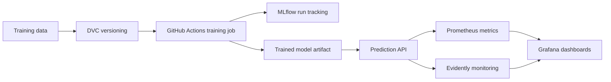

# MLOps Project

Please **use this repository as a template** for your MLOps project. Create pull requests in your own repository even if you are working alone, and use them to track the work you complete.

This repository is a template for an end-to-end MLOps project. You will turn a notebook-based model into a reproducible training pipeline, track experiments and artifacts, expose the model through an API, and monitor both predictions and data quality.

## Project Hub

- [README.md](./README.md): Repository overview, setup and workflow.
- [project-description.md](./project-description.md): Assignment brief, deliverables and suggested milestones.
- [requirements.txt](./requirements.txt): Pinned Python dependencies for the local environment.

## Learning Path

Work through the project in this order:

1. Refactor the training notebook into reusable Python modules or scripts.
2. Version the training data with DVC and track model runs with MLflow.
3. Automate training in a GitHub Actions workflow.
4. Serve the trained model through an API.
5. Monitor the API, predictions and incoming data with Evidently, Prometheus and Grafana.



## Reference Solution

A fully working reference implementation lives in [solution/README.md](solution/README.md).

That folder is self-contained and includes:

- reproducible data preparation with DVC,
- local MLflow logging during training,
- a FastAPI prediction service,
- Prometheus and Grafana monitoring,
- an Evidently report script for recent prediction requests.

If you want to inspect a complete baseline before building your own version, start there.

## Local Data Services

A typical local stack includes:

- an API service that loads the latest trained model,
- an MLflow tracking server for experiment runs and artifacts,
- a monitoring stack with Evidently, Prometheus and Grafana,
- a DVC remote or local storage path for versioned training data.

If you containerize the project, keep the services small and focused. A lightweight `docker compose` setup is enough for local validation.

## Environment

Please set up a new virtual environment. You can use the following commands:

### `macOS` / `Linux`

```bash
pyenv local 3.11.3
python3 -m venv .venv
source .venv/bin/activate
python -m pip install --upgrade pip
python -m pip install -r requirements.txt
```

### `Windows`

For `Git Bash` CLI:

```bash
pyenv local 3.11.3
python -m venv .venv
source .venv/Scripts/activate
python -m pip install --upgrade pip
python -m pip install -r requirements.txt
```

For `PowerShell` CLI:

```powershell
pyenv local 3.11.3
python -m venv .venv
.venv\Scripts\Activate.ps1
python -m pip install --upgrade pip
python -m pip install -r requirements.txt
```

Then copy the default local environment file:

**`macOS`** / **`Linux`** / **`Git Bash`**

```bash
cp .env.example .env
```

**`PowerShell`**

```powershell
Copy-Item .env.example .env
```

After copying `.env.example` to `.env`, keep the default local URLs unless you intentionally change the local stack ports.

## Learning Objectives

- Convert notebook experimentation into reusable training code.
- Automate retraining with GitHub Actions.
- Version training data and model artifacts with DVC and MLflow.
- Serve a trained model through an API.
- Monitor model behavior, data quality and operational metrics with an observability stack.
