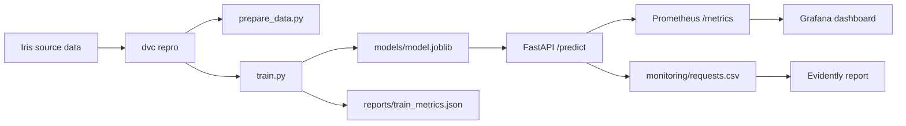

# Reference Solution

This folder contains a small but fully working reference solution for the MLOps project. It is intentionally minimal:

- one reproducible data preparation step,
- one training step that logs to a local MLflow tracking store,
- one FastAPI prediction service,
- one Prometheus and Grafana monitoring stack,
- one Evidently report script for recent prediction requests.

The goal is to show the complete flow without adding extra product features.

## Learning Path

If you are reading this solution to understand the project end to end, follow this order:

1. Run `dvc repro` to build the dataset and train the model.
2. Inspect `src/train.py` and `reports/train_metrics.json` to connect code to metrics.
3. Run the API and send a few prediction requests.
4. Open Prometheus and Grafana to inspect operational metrics.
5. Generate the Evidently report to compare request data with reference data.



## Folder Layout

```text
solution/
├── .dvc/
├── data/
├── models/
├── monitoring/
├── reports/
├── src/
├── docker-compose.yaml
├── dvc.yaml
└── requirements.txt
```

## What This Solution Does

The solution uses the built-in Iris dataset from `scikit-learn` so the project stays self-contained.

1. `src/prepare_data.py` exports the dataset to `data/raw/iris.csv`.
2. `src/train.py` trains a simple logistic regression pipeline, saves the model, and logs metrics and artifacts with a local MLflow SQLite tracking store.
3. `src/api.py` loads the trained model and exposes `/health`, `/predict` and `/metrics`.
4. `monitoring/prometheus.yaml` scrapes the API metrics endpoint.
5. `src/generate_report.py` uses Evidently to compare the reference training data with recent API requests.

## Create the Python Environment

### `macOS` / `Linux`

```bash
pyenv local 3.11.3
python -m venv .venv
source .venv/bin/activate
python -m pip install --upgrade pip
python -m pip install -r requirements.txt
```

### `Windows`

For `Git Bash` CLI:

```bash
pyenv local 3.11.3
python -m venv .venv
source .venv/Scripts/activate
python -m pip install --upgrade pip
python -m pip install -r requirements.txt
```

For `PowerShell` CLI:

```powershell
pyenv local 3.11.3
python -m venv .venv
.venv\Scripts\Activate.ps1
python -m pip install --upgrade pip
python -m pip install -r requirements.txt
```

Then copy the default local environment file:

**`macOS`** / **`Linux`** / **`Git Bash`**

```bash
cp .env.example .env
```

**`PowerShell`**

```powershell
Copy-Item .env.example .env
```

After copying `.env.example` to `.env`, keep the default local URLs unless you intentionally change the local stack ports.

## Run the Full Flow

### 1. Prepare the data and train the model

```bash
cd solution
dvc repro
```

This command:

- creates `data/raw/iris.csv`,
- trains the model,
- writes `models/model.joblib`,
- stores metrics in `reports/train_metrics.json`,
- logs artifacts and metrics to the local MLflow tracking files inside `mlflow.db` and `mlartifacts/`.

### 2. Start the API

```bash
cd solution
uvicorn src.api:app --reload
```

Open these endpoints:

- API docs: <http://127.0.0.1:8000/docs>
- Health check: <http://127.0.0.1:8000/health>
- Prometheus metrics: <http://127.0.0.1:8000/metrics>

### 3. Send a sample prediction request

```bash
curl -X POST http://127.0.0.1:8000/predict \
  -H "Content-Type: application/json" \
  -d '{
    "sepal_length_cm": 5.1,
    "sepal_width_cm": 3.5,
    "petal_length_cm": 1.4,
    "petal_width_cm": 0.2
  }'
```

Each request is appended to `monitoring/requests.csv`. This file is later used by the Evidently report.

### 4. Start Prometheus and Grafana

Run these services from a second terminal:

```bash
cd solution
docker compose up --build
```

Open:

- Prometheus: <http://127.0.0.1:9090>
- Grafana: <http://127.0.0.1:3000>

Default Grafana credentials:

- username: `admin`
- password: `admin`

The dashboard is provisioned automatically and shows request volume and average latency.

### 5. Generate an Evidently report

After sending at least five prediction requests:

```bash
cd solution
python src/generate_report.py
```

The report is written to `monitoring/reports/data_drift_report.html`.

## Notes About Simplicity

This reference solution stays deliberately small:

- It uses a local MLflow SQLite tracking store instead of a dedicated MLflow server.
- It uses DVC stages for reproducibility without adding a remote storage backend.
- It uses one simple classification model.
- It monitors the live API with Prometheus and Grafana without adding extra services.
- It generates the Evidently report from the logged request history instead of a larger monitoring database.

That makes the solution easy to read while still covering the full assignment workflow.
